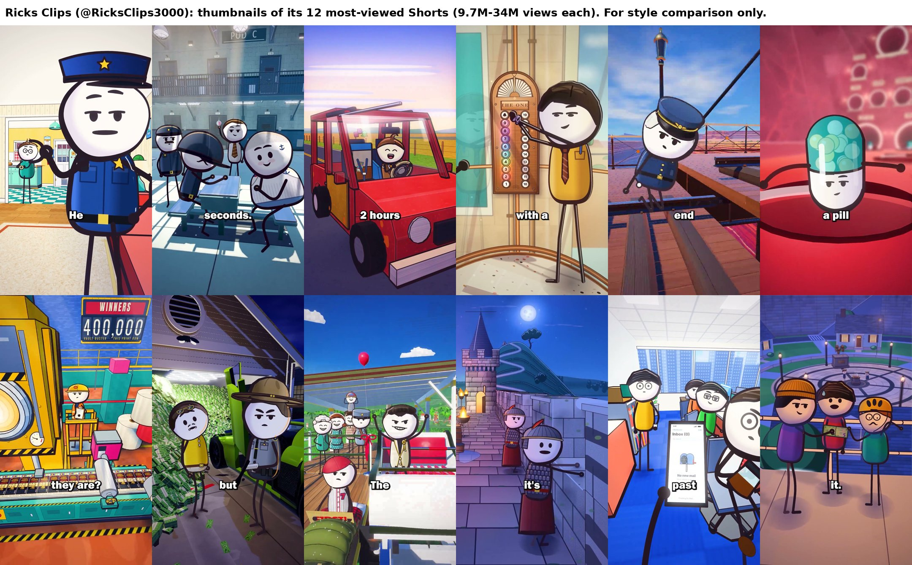

# Ricks Clips: how the channel's Shorts work

*Research for our new channel. Written 16 November 2026. For study only: we learn the patterns and
never copy their characters, worlds, titles or scripts.*

## 1. The channel at a glance

| | |
|---|---|
| Channel | Ricks Clips (@RicksClips3000), "Hey I'm Rick! Just a regular guy who loves doing voiceovers." |
| Subscribers | about 187,000 |
| Videos | 152 in total; 44 Shorts listed on the Shorts tab |
| Format | Vertical Shorts, about 55 seconds, flat 2D cartoon people inside bright 3D worlds, telling a strange true fact and the clever reason behind it |
| Started this format | October 2026, by a third-party report ([Revid.ai](https://www.revid.ai/true-story-cartoon-shorts)); another video claims 24 Shorts in 26 days ([YouTube](https://www.youtube.com/watch?v=X5WZeO9gIkE)). I couldn't verify either. |

### The most important finding: the format made the channel

The Shorts tab splits cleanly into two eras:

| | Old era: comedy skits | New era: "strange fact" explainers |
|---|---|---|
| Shorts | 14 | 30 |
| Total views | about 5 million | **about 278 million** |
| Typical (median) Short | 0.2 million | **8.8 million** |
| Shorts over 5 million | 0 | **20** |
| Shorts over 10 million | 0 | **9** |

Same channel, same narrator, about 40 times more views per Short. The format (2D characters in a
3D world telling a strange true fact) is what took off, not the channel's existing audience.

## 2. Topics: what wins and what flops

**The biggest hits** (views):

| Views | Title | What makes it work |
|---|---|---|
| 34M | The Ancient Jar That Warned an Empire | A strange object + a famous empire + it predicted danger |
| 29M | Why Perfect Railroads Don't Work | A "perfect" thing that fails, with a hidden reason |
| 18M | The Job Nobody Wants in Japan | A forbidden or absurd rule in a real country |
| 16M | Why Sailors Carried Storm Oil | An old-time object with a clever purpose |
| 16M | Your Brain's Secret Idea Zone | Something about *you*, made concrete |
| 15M | The Window That Breaks Japan's Gambling Law | A loophole around a law |
| 13M | What the Grave Bell Really Meant | A creepy object, plus the true story behind it |
| 11M | This Shape Saved Roller Coasters | An everyday thing with a hidden design reason |

**The flops** (under about 1 million):

| Views | Title | Why it probably failed |
|---|---|---|
| 0.1M | The Science Behind Slot Machines | Abstract explanation, no strange object or person |
| 0.3M | How Painkillers Actually Work | Textbook topic, no surprise |
| 0.6M | Every Memory Has a Price | Vague, no concrete thing to picture |
| 1.0M | This Tree Hates You | Joke title, unclear promise |

**The winning formula:** one **concrete, strange thing** (a jar, a window, a bell, oil, a cart, a
shape) + a **clear paradox or loophole** (it seems impossible, illegal or pointless) + a **real
reason** revealed at the end. History, old jobs, old laws and Japan show up again and again among
the hits. Pure "how X works" science does badly unless there's a strange object or person in it.

## 3. Titles

- **3 to 7 words.** They start with "The" (9 of 30), "Why" (6), "How" (4), "This" (3) and "What" (2).
- **They name the object, not the answer**: "The Ancient Jar That Warned an Empire", never "Chinese
  Seismograph Explained".
- **A built-in contradiction**: *perfect* railroads that *don't work*, a window that *breaks* a law, a
  burglar who *only moved furniture*.
- **No numbers, no emoji, no clickbait words** ("insane", "shocking") in the hits. The old comedy era
  used emoji ("Oh Nah 💀") and flopped.

## 4. The look (from the 12 thumbnails and the reel's frames)

**Characters**
- **Head:** a big white round head (about a third of the character's height), simple face: dot or
  small oval eyes, one-line eyebrows, a small mouth, sometimes glasses or a moustache.
- **Body:** a coloured bean or pill shape that doubles as clothing (a uniform, a striped shirt, a
  robe), with one or two details such as a tie, a badge or a belt.
- **Limbs:** thin black stick arms and legs with small round hands, no fingers.
- **Identity comes from the hat or hair:** police cap, sailor cap, pirate bandana, crown, helmet,
  beanie, top hat. You can tell who someone is from the hat in a split second.
- **Outlines:** thick, slightly wobbly black lines, hand-drawn in feel.
- **Expression:** mostly deadpan or smug, with sudden big reactions (sweat drop, shock lines, a
  grin). The deadpan face is part of the humour.

**Worlds**
- **Bright, real 3D places** with painted textures and black ink outlines: a prison block, a desert
  road, a castle wall at night, a lottery factory, a Japanese pachinko hall, a pirate ship.
- **Daylight and saturated colour.** Each story gets its own palette (teal and yellow, red and
  pink, deep blue at night) instead of one house colour.
- **The camera is close and often low**, with the main character filling half the frame. Busy,
  detailed backgrounds stay slightly soft.

**Captions**
- One word (sometimes two) at a time, white with a black outline, in the middle of the screen at
  about 70% of the height. No highlight colour.

## 5. How a script is built

*These numbers come from the analysis of 10 Ricks Clips Shorts shown on screen in the tutorial reel
("Get Rich With Me", Facebook). They're second-hand. I read them from the reel's frames but couldn't
re-measure them myself (see section 7).*

| Part | What they do | Numbers |
|---|---|---|
| Length | | 39 to 65 seconds, average 55 |
| Script size | | 139 to 232 words, average 185 |
| Speed | Fast and steady | about **3.35 words per second** (about 200 words per minute) |
| Hook | The first word lands at 0.0 s. One sentence, no greeting, no title. | about 15 words, finished by about 4.3 s |
| Hook types | (a) someone doing something odd: "A man snuck into a family's house every night and moved every single thing one inch to the left"; (b) "If you…" second person; (c) a rule and its exception: "Gambling is illegal in Japan. Yet…" | |
| Build | A chain of "So… / But… / Then…" beats. In 4 of 10, an authority laughs or objects early (the court laughs, the officer laughs, the captain shouts). | |
| Pivot | The explanation, usually starting "**You see…**" | at about **72%** of the video |
| Payoff | A "**So…**" line stating the consequence | at about **82–93%** |
| Ending | A plain closing line of about 12 words ("and on paper, nobody gambled"). No sign-off, no "subscribe", no call to action. Audio stops right at the end, so it loops. | |
| Dead air | Almost none: about 0.5 s of gaps in a whole video. A constant music bed runs under the voice. | |

## 6. Editing and camera

- **About 7 scene changes per video** (average shot about 9 seconds), mostly **dissolves**, not hard
  cuts.
- The camera **keeps moving inside each shot**: it travels through the 3D world, pushes in, tracks
  sideways and moves from one subject to the next without cutting. That's how they get long shots
  that never feel slow.
- Animation runs at the full 30 fps ("on ones"), so it's smooth, not choppy.

## 7. What I could and couldn't check

- **Checked directly:** subscriber and video counts, all 44 Shorts' titles and view counts (from the
  channel page, 16 Nov 2026), and the 12 most-viewed Shorts' first frames (thumbnails).
- **Not checked directly:** YouTube blocks this cloud machine from downloading the videos. So the
  script and editing numbers in sections 5–6 are the reel's measurements, not mine.
- **To go deeper:** download 5–10 of their Shorts (any downloader on your PC) into Google Drive and
  send me the folder link. I'll then watch them frame by frame and transcribe them with Whisper. That
  gives our own measurements: shot lengths, camera moves, word timings, and how each hook,
  escalation and payoff is phrased.

## 8. What this means for our new channel

1. **Topic rule:** one strange, concrete *thing*, plus a paradox or loophole, plus a true reason.
   Avoid textbook "how X works" topics unless there's a strange object or person to follow.
2. **Hook in the first sentence**, no intro. Start with the odd action, a "you" situation, or "X is
   illegal. Yet…".
3. **Script shape:** hook (0–4 s), "So / But / Then" escalation with someone doubting or laughing,
   the "You see…" pivot near 70%, a "So…" payoff near 85–90%, one plain closing line, and no call to
   action. End cleanly so it loops.
4. **Pace:** about 185 words in 55 seconds, with no dead air.
5. **Look:** a bright, varied 3D world per story, close low-angle camera, a big character, and
   one-word captions mid-screen.
6. **Characters:** simple round heads where the **hat or hair says who they are**. Ours must be
   clearly our own design: different head shape or eyes, body, outline and colours.
7. **Long, moving shots** (6–10 s) with dissolves and a camera that travels, rather than many hard
   cuts.
8. **Don't copy topics.** Their 30 topics are taken; we find our own strange objects and loopholes.
